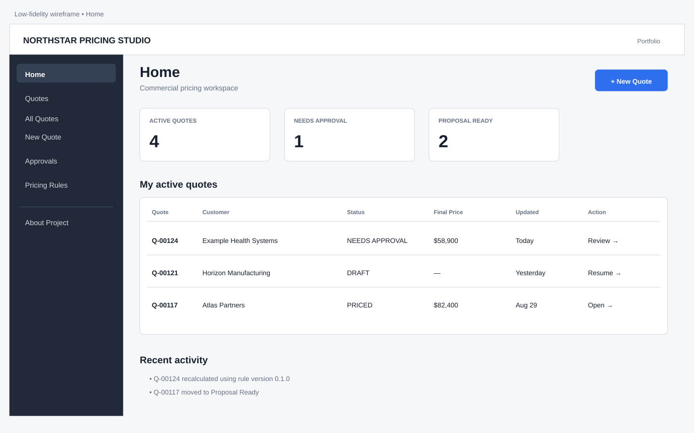
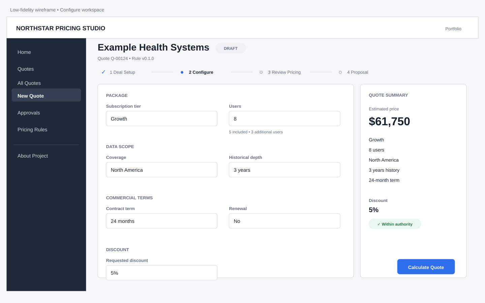
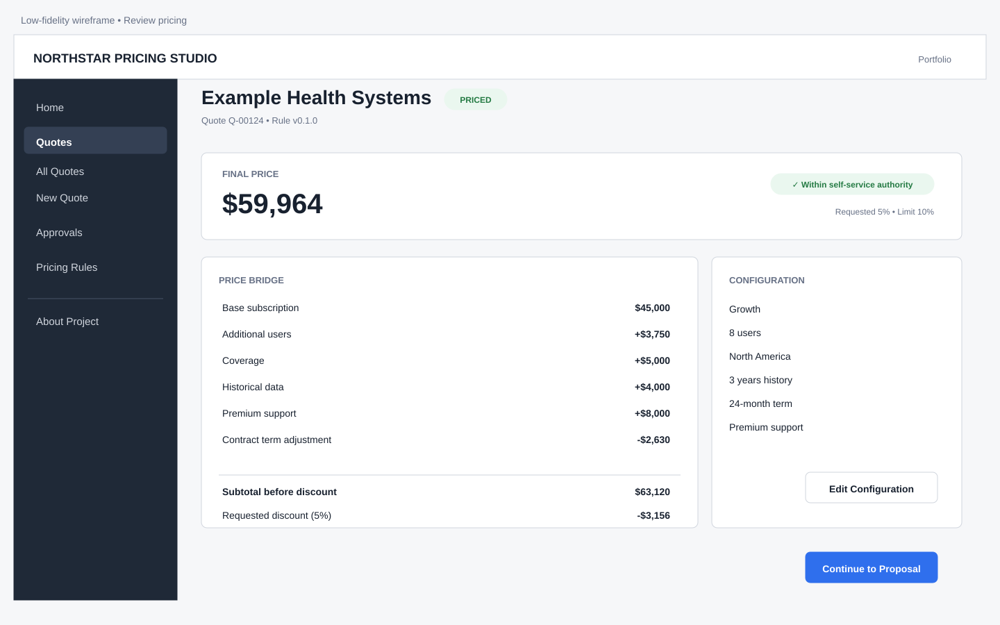
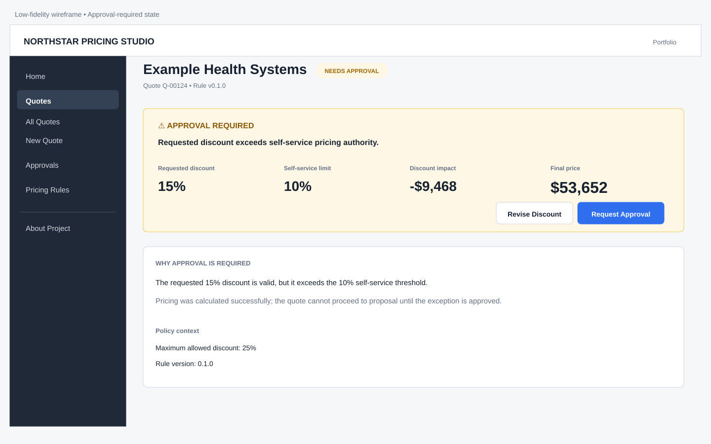
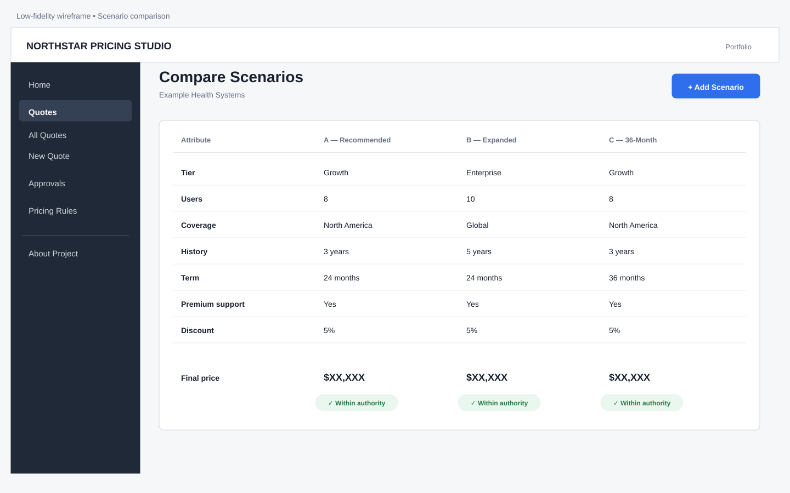
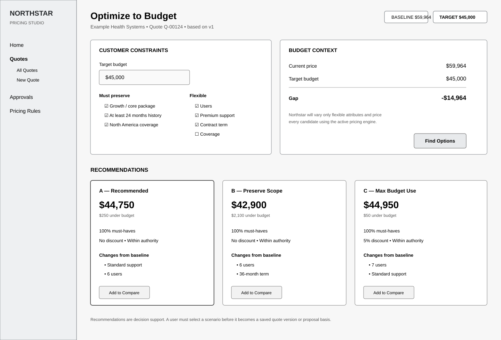

# Northstar Pricing Studio — Low-Fidelity Wireframes

These wireframes define hierarchy and behavior before visual polish or additional application code. They are intentionally low fidelity.

---


## Visual wireframe gallery

The SVGs below are deliberately low fidelity and are intended to lock hierarchy before implementation.













---


## Global application frame

```text
┌──────────────────────────────────────────────────────────────────────────────────────────┐
│ NORTHSTAR PRICING STUDIO                                             User / Portfolio     │
├───────────────────┬──────────────────────────────────────────────────────────────────────┤
│                   │                                                                      │
│  Home             │  PAGE CONTENT                                                        │
│  Quotes           │                                                                      │
│   • All Quotes    │                                                                      │
│   • New Quote     │                                                                      │
│  Approvals        │                                                                      │
│  Pricing Rules    │                                                                      │
│                   │                                                                      │
│  ─────────────    │                                                                      │
│  About Project    │                                                                      │
│                   │                                                                      │
└───────────────────┴──────────────────────────────────────────────────────────────────────┘
```

**Design intent:** a persistent enterprise application frame immediately separates Northstar from a single-page Streamlit demo.

---

## 1. Home

```text
┌──────────────────────────────────────────────────────────────────────────────────────────┐
│ Home                                                     [ + New Quote ]                 │
│ Good morning. Here is your commercial pricing workspace.                                │
├──────────────────────────────────────────────────────────────────────────────────────────┤
│  ACTIVE QUOTES              NEEDS APPROVAL              PROPOSAL READY                   │
│       4                           1                           2                             │
├──────────────────────────────────────────────────────────────────────────────────────────┤
│ My active quotes                                                                         │
│ ┌──────────┬────────────────────────┬──────────────┬─────────────┬────────────┬──────────┐ │
│ │ Quote    │ Customer               │ Status       │ Final Price │ Updated    │ Action   │ │
│ ├──────────┼────────────────────────┼──────────────┼─────────────┼────────────┼──────────┤ │
│ │ Q-00124  │ Example Health Systems │ Needs Appr.  │ $58,900     │ Today      │ Review → │ │
│ │ Q-00121  │ Horizon Manufacturing  │ Draft        │ —           │ Yesterday  │ Resume → │ │
│ │ Q-00117  │ Atlas Partners         │ Priced       │ $82,400     │ Aug 29     │ Open →   │ │
│ └──────────┴────────────────────────┴──────────────┴─────────────┴────────────┴──────────┘ │
│                                                                                          │
│ Recent activity                                                                          │
│ • Quote Q-00124 recalculated using rule version 0.1.0                                    │
│ • Quote Q-00117 moved to Proposal Ready                                                  │
└──────────────────────────────────────────────────────────────────────────────────────────┘
```

**Primary action:** New Quote  
**MVP note:** until persistence exists, the page can use clearly labeled demo data rather than pretending transient state is durable.

---

## 2. Deal Setup

```text
┌──────────────────────────────────────────────────────────────────────────────────────────┐
│ New Quote                                                                                │
│                                                                                          │
│  ● 1 Deal Setup ───── ○ 2 Configure ───── ○ 3 Review Pricing ───── ○ 4 Proposal        │
├──────────────────────────────────────────────────────────────────────────────────────────┤
│ Deal context                                                                              │
│ Create the commercial context first. Pricing configuration comes next.                   │
│                                                                                          │
│ Customer name *                                                                          │
│ [ Example Health Systems______________________________________________________ ]           │
│                                                                                          │
│ Deal type *                         Opportunity / reference                               │
│ (●) New business  ( ) Renewal       [ 2027 Data Subscription_________________ ]           │
│                                                                                          │
│                                                                        [ Continue → ]     │
└──────────────────────────────────────────────────────────────────────────────────────────┘
```

**Design intent:** avoid opening with fifteen pricing controls. Create the quote mental model first.

---

## 3. Configure — quote workspace

```text
┌──────────────────────────────────────────────────────────────────────────────────────────┐
│ Example Health Systems                                         DRAFT                     │
│ Quote Q-00124 • Rule v0.1.0                                                               │
│                                                                                          │
│  ✓ 1 Deal Setup ───── ● 2 Configure ───── ○ 3 Review Pricing ───── ○ 4 Proposal        │
├──────────────────────────────────────────────────────────────┬───────────────────────────┤
│ PACKAGE                                                      │ QUOTE SUMMARY             │
│ Subscription tier                                            │                           │
│ [ Growth ▼ ]                                                 │ Estimated price           │
│                                                              │ $61,750                   │
│ Users                                                        │                           │
│ [ 8 ]   5 included • 3 additional users                     │ Growth                    │
│                                                              │ 8 users                   │
│ DATA SCOPE                                                   │ North America             │
│ Coverage                                                     │ 3 years history           │
│ [ North America ▼ ]                                          │ 24-month term             │
│                                                              │                           │
│ Historical depth                                             │ Discount                  │
│ [ 3 years ▼ ]                                                │ 5%                        │
│                                                              │ ✓ Within authority        │
│ COMMERCIAL TERMS                                             │                           │
│ Contract term [ 24 months ▼ ]    [ ] Renewal                │                           │
│                                                              │                           │
│ SERVICES                                                     │                           │
│ [✓] Premium support                                          │                           │
│ [ ] Implementation services                                  │                           │
│                                                              │                           │
│ DISCOUNT                                                     │                           │
│ Requested discount [ 5% ]                                    │                           │
│ Self-service authority: up to 10%                            │                           │
│                                                              │                           │
│ [ Save Draft ]                            [ Calculate Quote ] │                           │
└──────────────────────────────────────────────────────────────┴───────────────────────────┘
```

### Behavior notes

- Summary rail remains visible as users configure the deal.
- Before the first calculation, price can display `Not calculated` rather than suggesting live pricing if the engine is still submit-based.
- Entitlement helper text sits beside the relevant control.
- Discount policy is visible before calculation.
- “Calculate Quote” is the dominant action; “Save Draft” becomes real only after persistence is implemented.

---

## 4. Review Pricing — within authority

```text
┌──────────────────────────────────────────────────────────────────────────────────────────┐
│ Example Health Systems                                         PRICED                    │
│ Quote Q-00124 • Rule v0.1.0                                                               │
│                                                                                          │
│  ✓ 1 Deal Setup ───── ✓ 2 Configure ───── ● 3 Review Pricing ───── ○ 4 Proposal        │
├──────────────────────────────────────────────────────────────────────────────────────────┤
│ FINAL PRICE                                                               $58,663        │
│ ✓ Within self-service pricing authority                                                  │
│ Requested discount 5% • Authority up to 10%                                              │
├──────────────────────────────────────────────────────────────┬───────────────────────────┤
│ PRICE BRIDGE                                                 │ CONFIGURATION             │
│                                                              │ Growth                    │
│ Base subscription                              $45,000        │ 8 users                   │
│ Additional users                              +$3,750        │ North America             │
│ Coverage                                      +$5,000        │ 3 years history           │
│ Historical data                               +$4,000        │ 24-month term             │
│ Premium support                               +$8,000        │ Premium support           │
│ Contract term adjustment                      -$2,630        │                           │
│ -----------------------------------------------------        │ [ Edit Configuration ]    │
│ Subtotal before discount                       $63,120        │                           │
│ Requested discount (5%)                       -$3,156        │                           │
│ =====================================================        │                           │
│ Final price                                    $59,964        │                           │
│                                                              │                           │
│ Why this price ▾                                             │                           │
│ • 3 users above the 5 included users                         │                           │
│ • North America coverage adjustment                          │                           │
│ • 24-month configured term adjustment                        │                           │
└──────────────────────────────────────────────────────────────┴───────────────────────────┘
│ Customer budget: $45,000  • Gap: $14,964                                             │
│ [ + Add Scenario ]   [ Optimize to Budget ] [ Compare Scenarios ] [ Continue to Proposal ]│
└──────────────────────────────────────────────────────────────────────────────────────────┘
```

**Design intent:** the first thing a commercial user sees is the decision: final price + authority state. The pricing table is subordinate to that decision.

> Values shown here illustrate hierarchy only; calculated values in the application remain the source of truth.

---

## 5. Review Pricing — approval required

```text
┌──────────────────────────────────────────────────────────────────────────────────────────┐
│ Example Health Systems                                  NEEDS APPROVAL                   │
│ Quote Q-00124 • Rule v0.1.0                                                               │
├──────────────────────────────────────────────────────────────────────────────────────────┤
│ ⚠ APPROVAL REQUIRED                                                                       │
│ Requested discount exceeds self-service pricing authority.                               │
│                                                                                          │
│ Requested discount            Self-service limit             Discount impact             │
│       15%                            10%                         -$9,468                   │
│                                                                                          │
│ Final price                                                               $53,652        │
│                                                                                          │
│ [ Revise Discount ]                                   [ Request Approval ]               │
├──────────────────────────────────────────────────────────────────────────────────────────┤
│ PRICE BRIDGE                                                       CONFIGURATION         │
│ [same explainable calculation hierarchy as standard review]       [summary]              │
├──────────────────────────────────────────────────────────────────────────────────────────┤
│ Proposal is locked until this exception is approved.                                      │
└──────────────────────────────────────────────────────────────────────────────────────────┘
```

**Important distinction:** approval required is a valid commercial state, not a failed calculation.

For the first release, `Request Approval` can be represented as a disabled or clearly marked future-workflow control unless an in-memory demo state is intentionally added.

---

## 6. Scenario Comparison

```text
┌──────────────────────────────────────────────────────────────────────────────────────────┐
│ Compare Scenarios                                                     [ + Add Scenario ] │
│ Example Health Systems                                                                   │
├───────────────────────┬──────────────────────┬──────────────────────┬─────────────────────┤
│                       │ A — Recommended      │ B — Expanded        │ C — 36-Month        │
├───────────────────────┼──────────────────────┼──────────────────────┼─────────────────────┤
│ Origin                │ Budget Fit           │ Manual               │ Budget Fit          │
│ Tier                  │ Growth               │ Enterprise           │ Growth              │
│ Users                 │ 8                    │ 10                   │ 8                   │
│ Coverage              │ North America        │ Global               │ North America       │
│ History               │ 3 years              │ 5 years              │ 3 years             │
│ Term                  │ 24 months            │ 24 months            │ 36 months           │
│ Premium support       │ Yes                  │ Yes                  │ Yes                 │
│ Discount              │ 5%                   │ 5%                   │ 5%                  │
├───────────────────────┼──────────────────────┼──────────────────────┼─────────────────────┤
│ Final price           │ $XX,XXX              │ $XX,XXX              │ $XX,XXX             │
│ Approval              │ ✓ Within authority   │ ✓ Within authority   │ ✓ Within authority  │
│ Budget variance        │ -$250                │ +$8,200              │ -$50                │
│ Must-haves             │ 100%                 │ 100%                 │ 100%                 │
├───────────────────────┼──────────────────────┼──────────────────────┼─────────────────────┤
│                       │ [ Select ]            │ [ Select ]           │ [ Select ]          │
└───────────────────────┴──────────────────────┴──────────────────────┴─────────────────────┘
```

### Behavior notes

- Give scenarios human-readable labels.
- Show scenario origin (`Manual` or `Budget Fit`) as quiet metadata.
- Highlight only differing configuration rows where possible.
- One scenario becomes the selected proposal basis.
- Do not implement arbitrary spreadsheet-style side-by-side editing in the first version.

---

## 7. Budget Fit — negotiation workspace

```text
┌──────────────────────────────────────────────────────────────────────────────────────────┐
│ Optimize to Budget                                      BASELINE $59,964                 │
│ Example Health Systems                                  TARGET   $45,000                 │
├──────────────────────────────────────┬───────────────────────────────────────────────────┤
│ CUSTOMER CONSTRAINTS                 │ BUDGET                                            │
│                                      │                                                   │
│ Target budget                        │ Current price                           $59,964     │
│ [ $45,000________________ ]          │ Target budget                          $45,000     │
│                                      │ Gap                                   -$14,964     │
│ Must preserve                        │                                                   │
│ [✓] Growth / core package            │ Northstar will vary only attributes marked       │
│ [✓] At least 24 months history       │ flexible and price every candidate through the   │
│ [✓] North America coverage           │ active pricing engine.                           │
│                                      │                                                   │
│ Flexible                             │                                  [ Find Options ] │
│ [✓] Users                            │                                                   │
│ [✓] Premium support                  │                                                   │
│ [✓] Contract term                    │                                                   │
│ [ ] Coverage                         │                                                   │
└──────────────────────────────────────┴───────────────────────────────────────────────────┘
│ RECOMMENDATIONS                                                                          │
│                                                                                          │
│ ┌──────────────────────┐ ┌──────────────────────┐ ┌──────────────────────┐              │
│ │ A — Recommended      │ │ B — Preserve Scope   │ │ C — Max Budget Use   │              │
│ │ $44,750              │ │ $42,900              │ │ $44,950              │              │
│ │ $250 under budget    │ │ $2,100 under budget  │ │ $50 under budget     │              │
│ │                      │ │                      │ │                      │              │
│ │ 100% must-haves      │ │ 100% must-haves      │ │ 100% must-haves      │              │
│ │ No discount          │ │ No discount          │ │ 5% discount          │              │
│ │ Within authority     │ │ Within authority     │ │ Within authority     │              │
│ │                      │ │                      │ │                      │              │
│ │ Changes:             │ │ Changes:             │ │ Changes:             │              │
│ │ - Standard support   │ │ - 6 users            │ │ - 7 users            │              │
│ │ - 6 users            │ │ - 36-month term      │ │ - Standard support   │              │
│ │                      │ │                      │ │                      │              │
│ │ [ Add to Compare ]   │ │ [ Add to Compare ]   │ │ [ Add to Compare ]   │              │
│ └──────────────────────┘ └──────────────────────┘ └──────────────────────┘              │
│                                                                                          │
│ Recommendations are decision support. Select a scenario before it becomes quote history.│
└──────────────────────────────────────────────────────────────────────────────────────────┘
```

### Behavior notes

- Budget is negotiation context, not a direct override of final price.
- Must-have attributes are hard constraints.
- Only dimensions marked flexible may be changed by the optimizer.
- Every recommendation must show price, budget variance, must-have coverage, approval state, and changes from baseline.
- Recommendations are generated through the canonical pricing engine.
- The user explicitly adds recommendations to comparison and selects the commercial path.
- If no valid option fits the target budget, show a no-solution state and the closest explainable alternatives rather than claiming success.

---

## 8. Proposal Preview

```text
┌──────────────────────────────────────────────────────────────────────────────────────────┐
│ Proposal Preview                                                   PROPOSAL READY        │
│ Example Health Systems                                                                   │
├──────────────────────────────────────────────────────────────────────────────────────────┤
│                                  NORTHSTAR ANALYTICS                                     │
│                                                                                          │
│                              Commercial Proposal                                         │
│                                                                                          │
│ Prepared for: Example Health Systems                                                     │
│                                                                                          │
│ Subscription                                                                    Growth  │
│ Users                                                                                8  │
│ Coverage                                                                  North America │
│ Historical depth                                                               3 years │
│ Contract term                                                                24 months │
│ Premium support                                                                    Yes │
│                                                                                          │
│ Investment                                                               $XX,XXX       │
│                                                                                          │
│ [customer-facing scope / commercial terms placeholder]                                  │
│                                                                                          │
├──────────────────────────────────────────────────────────────────────────────────────────┤
│ Internal metadata: Q-00124 • Scenario A • Rule v0.1.0                                   │
│                                                                                          │
│ [ Back to Pricing ]                              [ Generate Proposal ]                    │
└──────────────────────────────────────────────────────────────────────────────────────────┘
```

**Design intent:** demonstrate the end-to-end connection from configuration to customer-ready output before investing in PDF rendering.

---

## 9. Pricing Rules — read-only governance view

```text
┌──────────────────────────────────────────────────────────────────────────────────────────┐
│ Pricing Rules                                                                            │
│ Active rule version: 0.1.0                                      READ ONLY                │
├──────────────────────────────────────────────────────────────────────────────────────────┤
│ Subscription tiers                                                                      │
│ Core                       $25,000                                                       │
│ Growth                     $45,000                                                       │
│ Enterprise                 $75,000                                                       │
│                                                                                          │
│ User pricing                                                                            │
│ Included users             5                                                             │
│ Additional user            $1,250                                                        │
│                                                                                          │
│ Discount policy                                                                        │
│ Self-service authority     10%                                                           │
│ Maximum allowed            25%                                                           │
│                                                                                          │
│ Coverage / History / Term adjustments                                                   │
│ [grouped read-only tables]                                                               │
├──────────────────────────────────────────────────────────────────────────────────────────┤
│ Pricing behavior is loaded from versioned configuration rather than embedded in the UI. │
└──────────────────────────────────────────────────────────────────────────────────────────┘
```

**Portfolio value:** a reviewer can see the connection between pricing strategy, configuration, governance, and the YAML-backed architecture without opening the source code first.

---

# Interaction rules

## Primary action rule
Each screen should have one visually dominant next action.

| Screen | Primary action |
| --- | --- |
| Home | New Quote |
| Deal Setup | Continue |
| Configure | Calculate Quote |
| Review — standard | Continue to Proposal |
| Review — exception | Request Approval or Revise Discount |
| Scenario Comparison | Select Scenario |
| Budget Fit | Find Options / Add to Compare |
| Proposal Preview | Generate Proposal |

## Money formatting

- Use `$XX,XXX` or `$XX,XXX.XX` consistently based on business need.
- Negative pricing adjustments should display a minus sign.
- Avoid showing raw multipliers (for example `0.96`) on commercial screens; translate them into commercial explanations.

## Rule metadata

Show the rule version quietly but consistently. It is important for auditability but should not compete with the price or workflow state.

## Empty states

The product should explain the next action rather than display empty tables.

Example:

```text
No quotes yet
Create your first quote to configure pricing and see the governed price breakdown.
[ + New Quote ]
```

## Future-feature treatment

Do not create fake working controls. If a screen intentionally previews a later capability, either:
- omit the control until implemented, or
- label it transparently as a future workflow in a demo-specific build.

The portfolio should never imply persistence, approval routing, or document generation exists before it actually does.
